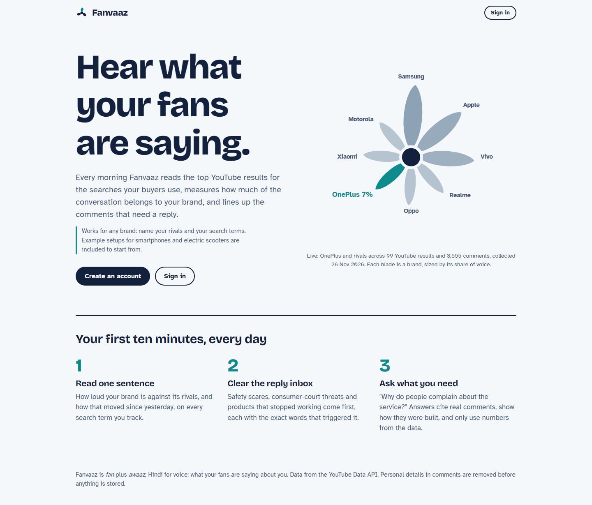
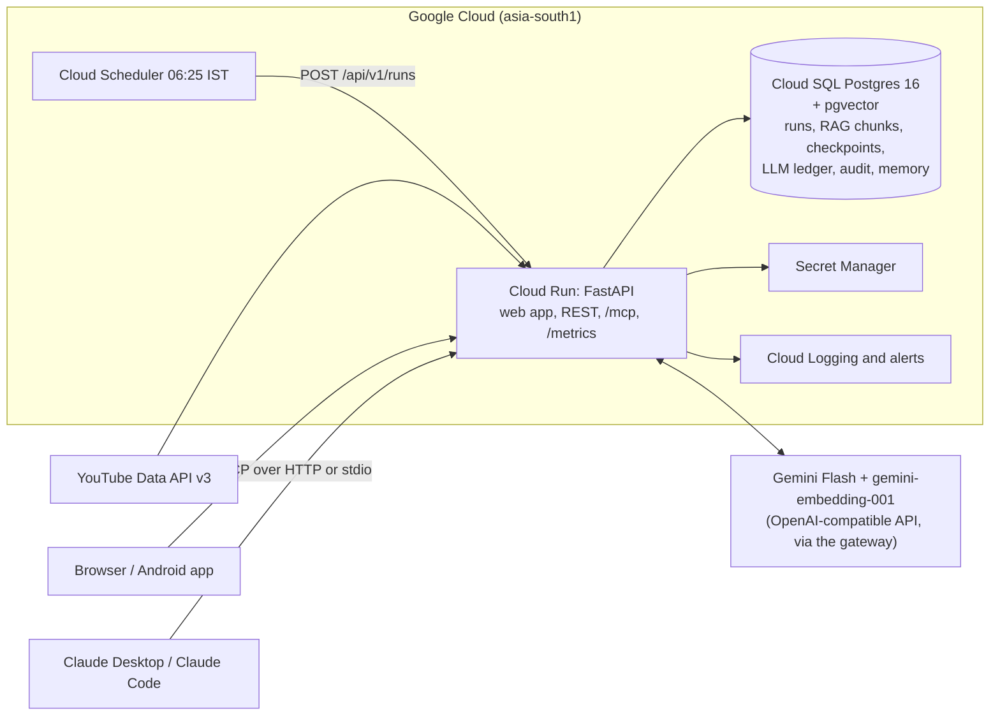
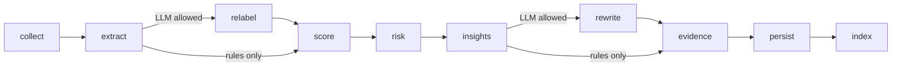
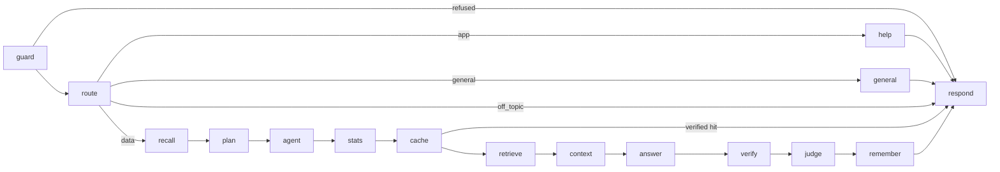

# Fanvaaz: a YouTube Share-of-Voice agent for any brand

[](https://github.com/Gurjas2112/Fanvaaz-State-of-Voice-Agent/actions/workflows/ci.yml)


Every morning Fanvaaz reads the top YouTube results for the searches your buyers use, measures how much of the
conversation belongs to your brand against its rivals, lines up the comments that need a reply, and answers
questions with citations to real comments. *Fanvaaz* is **fan** + **awaaz** (Hindi for voice).

It is built as an **AI-quality showcase**: two LangGraph agents with every AI-engineering control a production team
asks for (governance, guardrails, evidence, evaluation, observability, caching, cost and token control, memory,
an MCP server) and a test harness that runs on **real YouTube data, not synthetic demo data**.

| | |
| --- | --- |
| **Live app** | **https://fanvaaz-426966977732.asia-south1.run.app** (Cloud Run, asia-south1, Cloud SQL Postgres 16 + pgvector). Create an account at `/signup`; health at [`/ready`](https://fanvaaz-426966977732.asia-south1.run.app/ready) |
| **Android app** | [`app_screenshots_screen_recording/fanvaaz.apk`](app_screenshots_screen_recording/fanvaaz.apk): release-signed Capacitor app that opens the live service ([how it is built](#android-app-apk)); also on the [Releases](https://github.com/Gurjas2112/Fanvaaz-State-of-Voice-Agent/releases) page |
| **Walkthrough video** | [`app_screenshots_screen_recording/fanvaaz_walkthrough.mp4`](app_screenshots_screen_recording/fanvaaz_walkthrough.mp4) |
| **Screenshots** | [`web/`](app_screenshots_screen_recording/web/) (19 flows), [`mobile/`](app_screenshots_screen_recording/mobile/) (5 phone-browser flows), [`android/`](app_screenshots_screen_recording/android/) (the APK on an Android 13 emulator) |
| **AI system card** | [`docs/AI_SYSTEM_CARD.md`](docs/AI_SYSTEM_CARD.md) |
| **Latest run report** | [`docs/RUN_REPORT.md`](docs/RUN_REPORT.md) (generated from a real collection) |



---

## Results at a glance (measured on real YouTube data)

The offline tests replay a **recorded real collection**: 99 videos and 3,555 comments for 4 smartphone searches,
collected with the YouTube Data API, PII-redacted and replayed through the full agent. A live test calls the real API.

| What | Result | How it is measured |
| --- | --- | --- |
| Tests | **233 passed** on SQLite, the same suite on **Postgres 16 + pgvector**, 1 live test against the YouTube API | `make test`, `make pg-test`, `pytest -m live` |
| Brand-targeted sentiment, rules only, **real comments** | **macro-F1 0.73** (untouched holdout) | [`tests/golden/real_holdout.jsonl`](tests/golden/real_holdout.jsonl), hand-labelled |
| Same, hand-written sentences | macro-F1 0.86 (holdout) | the gap is the point: synthetic sets flatter rules |
| Retrieval ranking, 8 real questions, real Gemini embeddings | **MRR 0.94** hybrid (BM25 + pgvector, RRF, re-rank) vs 0.71 vector-only vs 0.44 BM25 | [`tests/golden/test_retrieval.py`](tests/golden/test_retrieval.py) |
| Prompt-injection red team | **40/40 blocked, 0/30 benign refused** | [`tests/safety`](tests/safety) |
| Real comments wrongly quarantined as injections | **0 / 3,555** (after fixing a false positive the real data exposed) | `reports/real_quarantine.json` |
| Insights with grounded numbers and resolvable citations | **100%** of every run | `verify` node + evidence pack |
| Web E2E (Playwright) | 21/21, incl. phone layout, PWA, follow-up memory | `make e2e` |

**Real data changed the engineering.** Switching from a synthetic demo dataset to real comments found five defects
that every synthetic test had missed. The sentiment rules scored 0.84 on hand-written sentences and **0.46** on real
comments. Emoji-only praise, Tamil and Hinglish slang, and "should be ashamed" all read as neutral, so the rules were
tuned on a real *dev* split and re-measured on an untouched real *holdout*, reaching 0.73.
The other four defects:
- The injection filter quarantined "made this video to *act as* a spokesperson".
- A safety alert's "reply within 24 hours" failed its own grounding check.
- Keywords containing numbers ("under 30000") broke the same check.
- Praise questions retrieved "Samsung in reels" memes.

Each fix has a regression test.

---

## The AI-engineering checklist, and where each item lives

| Concept | What Fanvaaz does | Code |
| --- | --- | --- |
| **AI governance** | YAML policy: model and task allow-lists, budgets, retention, what a model may never do; kill switch; append-only audit log of profile changes and runs; AI system card | [`governance.py`](fanvaaz/governance.py), [`policy.yaml`](fanvaaz/data/policy.yaml), [`AI_SYSTEM_CARD.md`](docs/AI_SYSTEM_CARD.md) |
| **AI reasoning** | The Ask agent plans before it retrieves: it resolves follow-ups from memory, splits comparisons into one sub-query per brand, detects praise or complaint intent, and falls back to an LLM planner limited to known brands. Every decision is returned as `reasoning_steps`, never hidden chain-of-thought | [`graph/ask_graph.py`](fanvaaz/graph/ask_graph.py) |
| **AI harness** | LangGraph checkpointing (SQLite or Postgres): a failed collection **resumes from its last node** (`fanvaaz resume`). Node retry policies, a circuit breaker on 401/402/403, and a harness of 9 test tools | [`graph/`](fanvaaz/graph), [`pipeline.py`](fanvaaz/pipeline.py) |
| **AI security** | Injection patterns plus a risk score; retrieved comments quarantined; PII and secret redaction on every output (egress DLP); per-user rate limit; MCP read/admin scopes; CSRF, scrypt, hashed sessions, CSP | [`guardrails.py`](fanvaaz/guardrails.py), [`auth.py`](fanvaaz/auth.py), [`mcp_server.py`](fanvaaz/mcp_server.py) |
| **Evidence generation** | Every insight carries its numbers *and* citations (YouTube video and comment links). The `verify` node rejects ungrounded numbers and dangling citations; an evidence pack per run is downloadable | [`evidence.py`](fanvaaz/evidence.py), `GET /api/v1/runs/{id}/evidence` |
| **Evaluation and ranking** | Golden sets (hand-written and real), metamorphic tests, retrieval recall@k/MRR, red team, DeepEval (faithfulness, relevancy, hallucination, G-Eval) and Ragas with Gemini as judge. Ranking is BM25 + pgvector, fused with RRF, then re-ranked on brand, aspect, sentiment intent, substance, likes and video rank, with an optional Vertex AI ranker | [`retrieval.py`](fanvaaz/retrieval.py), [`tests/`](tests) |
| **Observability and monitoring** | JSON logs for Cloud Logging; a span for every graph node; an LLM ledger; an **AI Ops** admin panel; Prometheus `/metrics`; `/ready`; log-based alert on failed runs | [`obs.py`](fanvaaz/obs.py), [`static/admin.js`](fanvaaz/static/admin.js) |
| **Prompt caching** | Three layers: provider prefix caching (static system text first; cached tokens recorded), an exact response cache, and a **verified semantic answer cache** (same run, same scope and intent, similar question, cited comments still present) | [`cache.py`](fanvaaz/cache.py) |
| **Prompt engineering** | Versioned YAML prompts with few-shot examples and a content hash; the version is logged on every call; promptfoo compares behaviour | [`prompts/`](fanvaaz/prompts), [`promptfoo/`](promptfoo) |
| **Schema evaluation** | Pydantic output contracts sent as `json_schema`, one repair retry with the validation error, and a schema-valid rate in AI Ops. Request bodies are strict (no coercion, no unknown fields) | [`schemas.py`](fanvaaz/schemas.py), [`ai.py`](fanvaaz/ai.py) |
| **MCP server** | 11 tools (SoV, insights, risks, hybrid search, grounded Ask, evidence, AI Ops, YouTube lookups, collection), 2 resources and a prompt, over stdio and HTTP at `/mcp` with Bearer scopes | [`mcp_server.py`](fanvaaz/mcp_server.py) |
| **AI memory** | Short-term: per-thread follow-ups ("and battery?") summarised after N turns. Long-term: saved or learned focus brands and aspects. Keyed by a hash, PII-redacted, both expiring | [`memory.py`](fanvaaz/memory.py) |
| **Context engineering** | A token-budgeted context: stats first, memory summary, then deduplicated, truncated, cited comments; reports how much of the budget was used and what was dropped | [`context.py`](fanvaaz/context.py) |
| **Cost optimisation** | The LLM re-checks only low-confidence rule labels; batching; caches; per-run and per-day USD caps; a cost ledger; YouTube quota accounting; Cloud Run scales to zero; budget alert | [`extract.py`](fanvaaz/extract.py), [`governance.py`](fanvaaz/governance.py) |
| **Token count** | A local pre-call estimate (Latin and Devanagari aware) gates every call; provider `usage` is recorded next to it with the estimate error; `fanvaaz tokens` compares with Gemini `countTokens` | [`tokens.py`](fanvaaz/tokens.py) |

---

## Architecture



### Agent 1: daily collection (LangGraph, checkpointed)



| Node | Does |
| --- | --- |
| `collect` | YouTube `search` → `videos` → `commentThreads` (retry policy; quota counted), or replays a recorded collection |
| `extract` | deterministic brand matching (aliases, Devanagari) + brand-targeted sentiment (comparatives, switches, negation, Hinglish, emoji) |
| `relabel` | Gemini re-checks only uncertain labels (schema-validated; cannot add brands) |
| `score` | Share of Voice per keyword |
| `risk` | escalation radar: safety, legal, product and service failures; framing-aware |
| `insights` → `rewrite` | rule-built recommendations, then an optional LLM polish that is rejected if it invents a number |
| `evidence` | citations + grounding verification |
| `persist` → `index` | append-only run; RAG chunks with embeddings (pgvector) |

### Agent 2: Ask (LangGraph)



Ask takes any question, the way a general assistant does, but keeps every claim about the data checkable:

| Step | What it does |
| --- | --- |
| **route** | Rules first (a brand named, data words, "how is SoV calculated"). The Gemini router decides only when the rules can't, choosing *data*, *app help*, *general category knowledge* or *out of scope*. Without a model, behaviour is unchanged. |
| **agent** | For rankings, trends, videos, risks and multi-brand questions, Gemini calls eight read-only tools ([`tools.py`](fanvaaz/tools.py)). Their outputs are the only numbers the answer may use, and bad tool names or arguments come back as messages, never errors. |
| **verify, then judge** | Numbers are grounded and citations resolved. Then a claim judge checks each sentence against the data: unsupported sentences are removed, and an answer that is mostly unsupported falls back to the extractive answer. The share of supported sentences is returned as `faithfulness`. |
| **general / help** | Category knowledge is labelled *"General knowledge, not from your data"* and carries no citations. Questions about the app get fixed, accurate help text. |
| **UX** | Streamed progress (`POST /api/v1/ask/stream`, server-sent events), suggested follow-ups, 👍/👎 feedback stored as evaluation data and summarised in AI Ops, and *Regenerate* (skips the answer cache). |

An open-question set ([`ask_open.jsonl`](tests/golden/ask_open.jsonl), 35 questions across the four routes) gates routing offline. With Gemini (`pytest -m llm`) it also measures route accuracy, decline precision and mean faithfulness.

### The Share of Voice metric

Each result at rank r is discounted by **w(r) = 1 / log2(r + 1)** (rank 1 = 1.00, rank 10 = 0.29, rank 50 = 0.18).

| Part | Definition |
| --- | --- |
| **M**, mention share | rank-weighted mentions (title 2, description 1, each comment 1) |
| **E**, engagement share | rank-weighted `ln(1+views) + 2 ln(1+likes) + 3 ln(1+comments)`, split among the brands a video mentions |
| **P**, share of positive voice | rank-weighted positive mentions |
| **SoV** | **0.3 M + 0.4 E + 0.3 P** (configurable; all parts reported) |

**Why N = 50:** one `search.list` page returns 50 results and the rank weight already makes result 50 count 18% of
result 1. Cost ≈ 151 quota units per keyword, so a 6-keyword profile uses about 906 of the 10,000 free daily units.

### Risk radar

Weighted, negation-aware and brand-attributed escalation flags (safety 50, legal or consumer 30, product failure 20,
service failure 15, plus 10 if the mention is negative, scaled by comment likes). The approach comes from the author's
[CRIF India hackathon project](https://github.com/Gurjas2112/CRIF-Hackathon-2023) (1st prize, COEP Mindspark 2023).
Real comments added **framing awareness**: "the thumbnail makes it look like it's on fire" is about the video, not
the product.

---

## Quick start

```bash
pip install -e ".[dev]"
cp .env.example .env            # add FANVAAZ_YOUTUBE_API_KEY (and optionally a Gemini key)
make replay                     # score the recorded real collection: no key, no network
make serve                      # http://127.0.0.1:8000, sign in with FANVAAZ_ADMIN_EMAIL / _PASSWORD
make live                       # collect live YouTube data now (~600 quota units for 4 keywords)
```

Production-like stack on Postgres + pgvector: `docker compose up --build`.

### Track your own brand in 5 minutes

1. Sign in as the admin. A fresh install tracks nothing, and the admin page shows an onboarding step.
2. Pick an example template (`smartphones-india`, `ev-scooters-india`) or paste your own profile: your brand, up to
   19 rivals with the spellings people use (including Hindi script), up to 10 YouTube searches, aspects and
   playbook actions, extra risk phrases.
3. Click **Collect live from YouTube now** and watch the LangGraph nodes tick through.
4. Past runs keep the brands they tracked; the profile change is in the audit log.

**Several products side by side.** Use **Add as another product** to track a second category, for example
smartphones and EV scooters, without replacing the first. A switcher in the header picks the product per browser
(the `fz_profile` cookie), and API and MCP clients pass `?profile=<id>`. Each request is scoped through a context
variable, so concurrent requests for different products never mix; a test checks this. The daily job
(`{"profile": "all"}`) collects every product, and runs, briefs, Ask and exports all follow the selected product.

---

## Quality harness

| Gate | Tool | Threshold | Measured |
| --- | --- | --- | --- |
| Unit, graph, platform (gateway, cache, budgets, circuit breaker, memory, migrations, resume) | pytest, httpx MockTransport | all pass | **233 passed** (SQLite) and the same suite on Postgres + pgvector |
| Metamorphic properties | Hypothesis | 0 violations | order, brand-less text, alias spelling, antisymmetric comparatives |
| Sentiment, **real comments** | golden `real_holdout` (never tuned on) | macro-F1 ≥ 0.70 | **0.73** (real dev: 0.88) |
| Sentiment, hand-written | golden `holdout` | macro-F1 ≥ 0.80 | **0.86** (dev: 0.99) |
| Brand detection | golden `holdout` | F1 ≥ 0.95 | **1.00** |
| Retrieval ranking, no vectors | 8 real questions, pooled judgments | hybrid ≥ BM25, recall@5 ≥ 0.6 | **recall@5 0.73, P@5 0.68, MRR 0.84** (BM25: 0.25 / 0.23 / 0.44) |
| Retrieval ranking, with vectors | same questions, `gemini-embedding-001` at 768 dims over 3,431 real comments (`pytest -m llm`) | vector finds relevant, hybrid MRR ≥ BM25 | hybrid **recall@5 0.70, P@5 0.63, MRR 0.94**; vector-only 0.45 / 0.40 / 0.71; BM25 0.25 / 0.23 / 0.44 |
| Red-team refusal | own corpus, 40 attacks / 30 benign | ≥ 95% blocked, ≤ 5% false refusals | **40/40, 0/30** |
| Injection false positives on real data | 3,555 real comments | ≤ 0.2% | **0** |
| LLM guard paths | fake LLMs that lie, leak PII, invent brands, return invalid JSON, hit 402 | rejected, repaired or circuit-broken | all pass |
| Live data | real YouTube API through the graph | PII-free, quota ≤ 120 units | pass (`pytest -m live`) |
| Web E2E | Playwright | all pass | **21/21** |
| API contract | Postman + Newman | all pass | in CI (`live-api` job) |
| API fuzzing | Schemathesis | 0 failures | in CI |
| Behaviour and refusal | promptfoo on live `/ask` | all pass | in CI |
| Load | k6 | p95 < 500 ms | in CI |
| Faithfulness and hallucination | DeepEval, Ragas (Gemini judge) | faithfulness ≥ 0.8 | `make llm-evals` (needs a funded Gemini key; not yet run, see below) |
| Android | Appium (UiAutomator2) | all pass | CI emulator job |

**Why four golden sets.** Hand-written sentences are clean; real comments are emoji, Hinglish, Tamil and typos. Rules
were tuned only on the *dev* splits; the *holdout* splits are the honest numbers. The real sets were sampled with the
brand matcher, so they measure sentiment only; brand recall is measured on the hand-written sets. Each set has about 60
brand pairs and one labeller, so read the decimals with care.

**What the harness caught**
- **Real data**: the five defects above (sentiment gap, an injection false positive, a self-inflicted grounding
  failure, numbers in keywords, meme retrieval).
- **The live Gemini run**: the key's prepaid credits were depleted (HTTP 402 on every call). The agent completed on
  rules as designed, but tried all 45 batches, so a **circuit breaker** now stops after the first 401/402/403.
- **Playwright**:
  - The "Show more" button ignored its `hidden` attribute.
  - The admin page was 476 px wide on a 390 px phone: a visually hidden table label escaped its scroll container.
  - Earlier, stacked toasts and a header overflow.
- **Schemathesis**: 9 defects in earlier rounds. Among them:
  - A user id of 2^63 caused a 500.
  - `"active": 0` was coerced to `false`.
  - Python's and JSON Schema's `\s` disagree on valid emails.
  - The 405 `Allow` header was incomplete.

---

## MCP server

Use Fanvaaz from Claude Desktop or Claude Code: **stdio** locally, or **HTTP** against the deployed service.

```jsonc
// Claude Desktop: claude_desktop_config.json
{ "mcpServers": { "fanvaaz": { "command": "fanvaaz", "args": ["mcp"] } } }
```
```bash
# Claude Code against Cloud Run (read-only token from Secret Manager: fanvaaz-mcp-token)
claude mcp add --transport http fanvaaz https://<service-url>/mcp/ --header "Authorization: Bearer <token>"
```

Tools: `get_share_of_voice`, `list_keywords`, `get_insights`, `get_risks`, `search_comments`, `ask_fanvaaz`,
`get_evidence`, `get_ai_ops`, `youtube_video_info`, `youtube_video_comments` (1 quota unit each),
`youtube_search` and `run_collection` (admin scope). Resources: `fanvaaz://profile`, `fanvaaz://policy`. Prompt: `weekly_brief`.

The YouTube tools take their ideas from [temiedani/youtube-mcp-server](https://github.com/temiedani/youtube-mcp-server)
but none of its code. That project:
- authenticates with OAuth only (its documented API-key variable is never read);
- writes `print()` output to stdout, which corrupts the stdio JSON-RPC stream;
- relies on `relatedToVideoId`, which YouTube removed;
- has no quota handling or license file.

Fanvaaz rebuilds the same tools on its own collector, with API-key auth, quota accounting, PII redaction and stderr logging.

---

## Deploy to Google Cloud

```bash
gcloud auth login
gcloud config set project <your-project-id>
ADMIN_EMAIL=you@example.com bash deploy/gcp_cloud_run.sh     # or: make deploy
```

[`deploy/gcp_cloud_run.sh`](deploy/gcp_cloud_run.sh) is idempotent. It:
- enables only the APIs it needs;
- creates a least-privilege service account;
- stores secrets in **Secret Manager**, typed at prompts and never written to files: the YouTube key, the admin
  password and an optional Gemini key, plus generated API and MCP tokens and the database URL;
- creates **Cloud SQL Postgres 16** (pgvector, encrypted connections only, daily backups);
- deploys **Cloud Run** from the Dockerfile: 0–3 instances, the Cloud SQL socket, JSON logs, admin-only `/docs`;
- schedules the daily live collection with **Cloud Scheduler**;
- adds a log-based alert on failed runs and a monthly **budget alert**.

Cloud SQL is billed while it runs, so check the price of your tier first. Then trigger the first collection:
`gcloud scheduler jobs run fanvaaz-daily --location=asia-south1`.

## Android app (APK)

[`mobile/`](mobile) is a **Capacitor 6** Android shell around the deployed web app. The site is also an installable
**PWA**, with a manifest and a service worker that caches only the shell, so data is always live. It has its own
launcher icons and splash screens and is release-signed; the keystore stays outside the repository.

```bash
cd mobile && npm install
APP_URL=https://<service-url> npm run sync
cd android && ./gradlew assembleRelease        # app/build/outputs/apk/release/app-release.apk
```

Set `FANVAAZ_ANDROID_ASSET_LINK=app.fanvaaz.sov:<SHA-256>` on the server to serve Digital Asset Links.

---

## API

OpenAPI at `/docs` (admin-only in production). Authentication is a session cookie (with `X-Requested-With: fanvaaz`
on writes) or `Authorization: Bearer <FANVAAZ_API_TOKEN>`.

| Endpoint | Purpose |
| --- | --- |
| `GET /health`, `GET /ready` | liveness; database, migrations, YouTube key and LLM checks |
| `GET /api/v1/brief`, `/sov`, `/keywords`, `/insights`, `/risks` | the daily views |
| `POST /api/v1/ask` (`thread_id` for follow-ups) | grounded answer, citations, reasoning steps, cache info |
| `GET /api/v1/runs/{id}/evidence` | evidence pack |
| `POST /api/v1/runs` · `POST /api/v1/runs/jobs` + `GET …/jobs/{id}` | synchronous collection (Scheduler) or background job with progress (UI) |
| `GET /api/v1/admin/ai-ops`, `/audit`, `/graphs`, `/traces/{id}` · `GET /metrics` | AI operations, audit trail, Mermaid graphs, spans, Prometheus |
| `GET/PUT /api/v1/me/prefs` · `DELETE /api/v1/ask/threads/{id}` | long-term memory; forget a conversation |
| `GET /api/v1/export/{sov,risks,mentions}.csv` | Tableau, Power BI and Excel (formula-injection safe) |
| `/mcp` | MCP over streamable HTTP |

## Configuration

Every setting is an environment variable with the `FANVAAZ_` prefix; see [`.env.example`](.env.example). The main
ones are `YOUTUBE_API_KEY`, `DATABASE_URL`, `LLM_BASE_URL`, `LLM_API_KEY`, `LLM_MODEL` (default
`gemini-flash-latest`), `EMBED_MODEL`, `LLM_ENABLED`, `MAX_COST_PER_RUN_USD`, `MAX_COST_PER_DAY_USD`,
`MAX_PROMPT_TOKENS`, `PROFILE`, `ADMIN_EMAIL` and `ADMIN_PASSWORD`, `API_TOKEN` and `MCP_TOKEN`.

## Limitations

- The daily Cloud Scheduler call collects every product in sequence inside one 30-minute request (about 8 minutes
  per product with 4 search terms), so it fits about three products. For more, schedule one job per product
  (`{"profile": "<id>"}`).

- The LLM-graded metrics (DeepEval, Ragas) need a funded Gemini key. Without one, Fanvaaz runs on rules and
  BM25, and this README reports only numbers that actually ran.
- Golden sets are small and single-labeller; retrieval judgments are pooled. The pool was judged before the
  vector leg existed, so comments only vector search finds count as misses: vector scores are a lower bound.
  On these 8 questions, adding vectors lifted MRR (0.84 → 0.94) but cost a little recall@5 (0.73 → 0.70).
- Rule sentiment still reads "this phone is fire" (praise) literally; that case is a tracked `xfail`.
- Rate limiting and login throttling are per instance.

## Project layout

```
fanvaaz/            app: api, graph/ (two LangGraph agents), ai (gateway), governance, obs, cache, context,
                    memory, retrieval, evidence, prompts/, schemas, tokens, db (SQLite/Postgres + migrations),
                    mcp_server, collector, sentiment, risk, sov, insights, static/ (web app + PWA)
tests/              unit, golden (hand-written + real), safety, api, e2e (Playwright), mobile (Appium),
                    llm (DeepEval/Ragas), live (YouTube API), fixtures/youtube_snapshot (recorded real data)
deploy/             gcp_cloud_run.sh
mobile/             Capacitor Android app
scripts/            record_snapshot, capture_flows, run_report
promptfoo/ postman/ load/   behaviour, contract and load suites (CI)
app_screenshots_screen_recording/   flow screenshots, walkthrough video, APK
```

## References

These study notes shaped the design. They are not included in the repo:
- *Agentic Design Patterns with LangGraph* and *LangGraph in Production: Architectural Limitations*
- *Asynchronous Verified Semantic Caching for Tiered LLM Architectures*
- *Mastering LLM-as-a-Judge* (Galileo), the *RAG Guide* and *Building Agentic RAG*
- *Prompt Engineering*, *Top 9 LLM API Parameters*, *AIOps & MLOps* and *Designing ML Systems* (O'Reilly)

YouTube data comes from the YouTube Data API v3 and is subject to the YouTube API Services Terms. Comment text is
PII-redacted, and commenter identities are hashed.

MIT licence.
