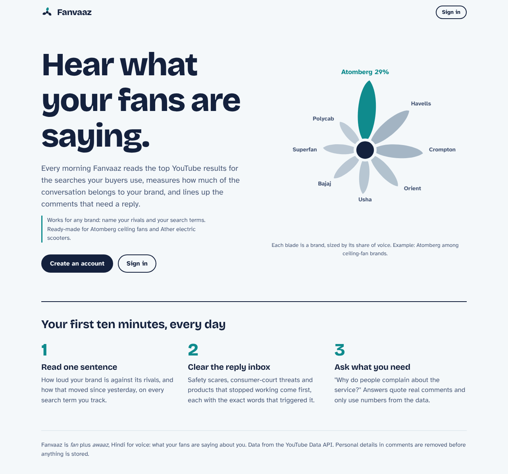
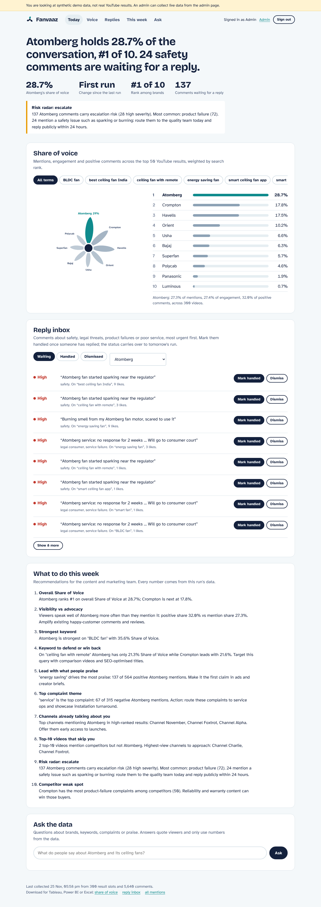
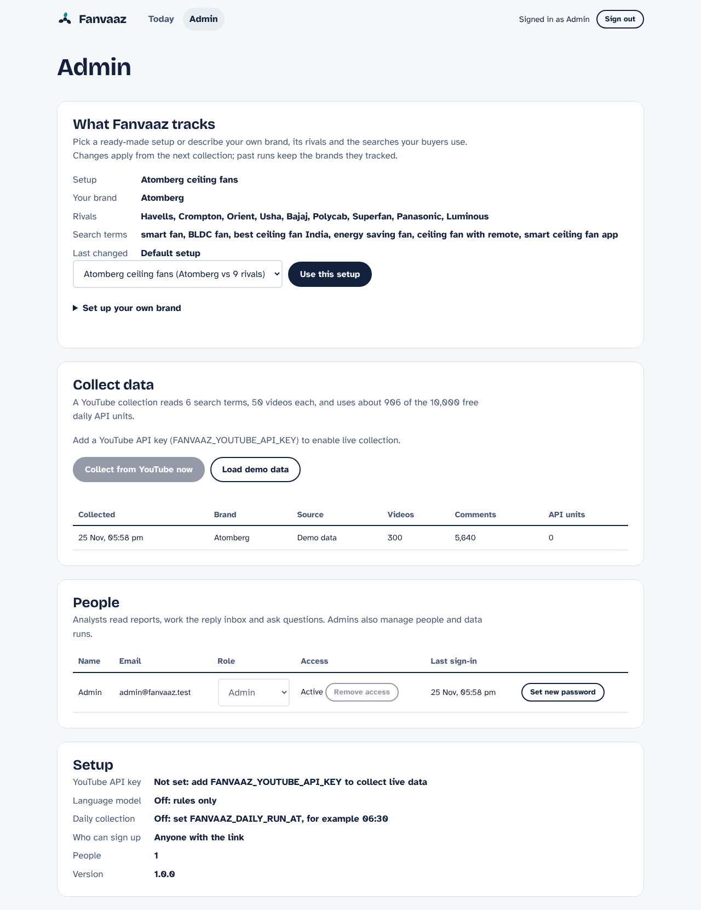

# Fanvaaz

**Hear what your fans are saying.** A daily YouTube Share of Voice desk for any brand, with a reply inbox
for risky comments, and a test harness that grades the AI behind it.

*Fanvaaz* = *fan* + *awaaz* (Hindi for voice): what your fans are saying about you.

You tell Fanvaaz your brand, its rivals and the searches your buyers use (a **tracking profile**). It searches
YouTube for each keyword, reads the top 50 videos and their top comments, finds every brand mention, scores the
sentiment aimed at each brand (English and Hinglish), and reports your Share of Voice against the rivals.
It ships with two ready-made profiles: **Atomberg ceiling fans** (the worked example and the bundled demo data:
"smart fan" plus five related searches, nine rivals) and **Ather electric scooters**. It then writes evidence-backed recommendations for the
content and marketing team, and lets them ask follow-up questions in plain language.

Every stage is guarded and gated in CI: golden-set accuracy, metamorphic properties, LLM faithfulness
(DeepEval, Ragas), red-team refusal (promptfoo), API contract (Postman/Newman, Schemathesis), web E2E
(Playwright), Android (Appium) and load (k6).

| Landing | Today (signed in) | Admin |
| --- | --- | --- |
|  |  |  |

> Screenshots use the bundled **synthetic** dataset so everything runs with no keys; the app shows a banner saying
> so. Run a live collection (below) for real findings.

---

## Quick start

```bash
git clone https://github.com/Gurjas2112/Fanvaaz-SoV-Agent.git && cd Fanvaaz-SoV-Agent
pip install -e ".[dev]"
export FANVAAZ_ADMIN_EMAIL=you@example.com FANVAAZ_ADMIN_PASSWORD='choose-a-long-passphrase'
fanvaaz run --source demo           # seed from the bundled synthetic dataset (no keys, no network)
fanvaaz serve                       # http://127.0.0.1:8000 -> sign in at /login (API docs at /docs)
pytest -m "not mobile and not llm" # every offline gate + Playwright
```

Live data (needs a free YouTube Data API v3 key):

```bash
cp .env.example .env               # set FANVAAZ_YOUTUBE_API_KEY (and optionally an LLM)
fanvaaz run --source youtube     # ~906 of the 10,000 free daily quota units
python scripts/two_pager.py        # writes docs/TWO_PAGER.md for the submission
```

Docker: `docker compose up --build` (seeds a demo run on first boot, serves on :8000).

## Track any brand

What Fanvaaz tracks is data, not code. A tracking profile names:

| Field | Example (Ather) | Used for |
| --- | --- | --- |
| `focus_brand`, `brands` | `Ather` vs Ola Electric, TVS iQube, Bajaj Chetak, Hero Vida, each with the spellings people use (`"ola s1"`, `"iqube"`) | brand matching, ranking, whose inbox comes first |
| `keywords` | `best electric scooter India`, `electric scooter range test` (up to 10, about 151 API units each) | YouTube searches |
| `category` | `electric scooters` | LLM prompts, the Ask box |
| `aspects`, `playbook` | `range`, `charging`, `service` → "publish real-world range tests" | *why* people praise or complain, and what to do |
| `risk_terms` | `battery fire`, `brake failure` | extra risk phrases on top of the generic ones (fire, shock, consumer court, refund, not working) |

Switch or define one in three ways:

```bash
fanvaaz profile list                      # presets; * marks the one in use
fanvaaz profile use ather-scooters        # or: fanvaaz profile use my-brand.json
fanvaaz profile show > my-brand.json      # start your own from the current one
```

or in **Admin → What Fanvaaz tracks** (pick a preset, or edit the profile and save), or with
`FANVAAZ_PROFILE=<id or path>` as the default for a new install. Every profile is validated before it is saved: the
focus brand must be one of the brands, an alias can belong to only one brand, there are 2 to 20 brands and 1 to 10
keywords, and errors say which field is wrong.

Each run stores the profile it used, so switching never rewrites history: past runs keep their brands, and
"since the last run" only compares runs that tracked the same focus brand. Only the Atomberg profile has bundled
demo data; any other profile collects live from YouTube.

---

## The product

| Page | Who | What it is for |
| --- | --- | --- |
| `/` | anyone | What Fanvaaz does, with an example share-of-voice fan; sign in or create an account |
| `/signup`, `/login` | anyone | Accounts; sign-up can be limited to company domains (`FANVAAZ_SIGNUP_DOMAINS=yourbrand.com`) |
| `/app` | analysts, admins | **Today**: one-sentence brief with change since the last run · **Voice**: the fan chart and ranking per search term · **Reply inbox**: risk comments to mark handled or dismissed (status carries over to later runs) · **This week**: recommendations · **Ask**: guarded Q&A · CSV downloads |
| `/admin` | admins | What Fanvaaz tracks (preset or custom profile), collect from YouTube or load demo data, run history and API units, people (role, access, password reset), setup status |

No other pages: password reset is done by an admin (no email service needed), and settings live in environment
variables shown on the admin page.

**Designed for daily use.** The first screen is one sentence ("Atomberg holds 28.7% of the conversation, #1 of 10,
up 1.2 pts since the last run. 24 safety comments are waiting for a reply."), then the inbox. With
`FANVAAZ_DAILY_RUN_AT=06:30` a fresh collection lands every morning; a date-keyed claim row stops two workers
collecting twice.

**Visual identity.** The share of voice is drawn as a ceiling fan: one swept blade per brand, its length growing
with the square root of the share (so blade *area* stays honest), your brand in breeze teal `#0F8B8D`. It spins once
on load and stays still under `prefers-reduced-motion`. Type is Bricolage Grotesque for headlines and Atkinson
Hyperlegible for reading, both self-hosted (SIL OFL), so the pages make no third-party requests.

### Accounts and security

| Control | Implementation |
| --- | --- |
| Passwords | scrypt (n=2^14, r=8, p=1), per-user salt, constant-time compare; min 10 characters, common-password list |
| Sessions | 32-byte random token in an `HttpOnly`, `SameSite=Lax` cookie (`Secure` behind HTTPS); only its SHA-256 is stored; revoked on logout, deactivation or password reset |
| CSRF | cookie-authenticated writes need `X-Requested-With: fanvaaz`; no CORS is allowed |
| Brute force | 5 failed sign-ins per email per 15 minutes → 429; same message and work for unknown emails |
| Roles | `analyst` (read, triage, ask) and `admin` (people, runs); the last active admin cannot be removed, and admins cannot demote themselves |
| Automation | `Authorization: Bearer $FANVAAZ_API_TOKEN` for CI tools (Newman, promptfoo, Schemathesis, k6) |
| Requests | strict bodies: no type coercion (`"active": 0` is rejected) and no unknown fields |
| Pages | CSP `default-src 'self'` (no inline script), `X-Frame-Options: DENY`, `nosniff`, open-redirect-safe `?next=` |

### MCP servers: none added, on purpose

The problem statement needs an agent and a two-pager; the role needs test automation and LLM evaluation. Fanvaaz
already calls the official YouTube Data API directly, so a community YouTube MCP server would wrap the same API and
add a dependency without adding capability. Exposing Fanvaaz itself as an MCP server would be optional, so it is
left out.

## How it works

```
YouTube Data API ─▶ Collector ─▶ Extractor ─────▶ SoV engine ─▶ FastAPI ─▶ Dashboard (web + mobile)
   search/videos/     ranks,       brands (rules)    M, E, P,       /sov        Ask the data
   commentThreads     stats,       sentiment         SoV            /insights
                      PII redacted (rules | LLM)          │         /ask ◀── guardrails + grounding
                                        │                 ▼
                                        └────────▶ Insights (rules, optional LLM rewrite, grounded)
```

| Stage | What it does | Where |
| --- | --- | --- |
| Collect | `search.list` (N=50, region IN) → `videos.list` → `commentThreads.list` (100 top comments). Retries, quota accounting, comments-disabled handling; raw JSON saved per run for replay | `collector.py` |
| Redact | Emails and Indian phone numbers replaced at ingestion, before anything is stored or sent to an LLM; commenter ids stored as hashes | `text.py` |
| Brands | Deterministic alias matcher with word boundaries ("Renesa", "atom berg", "एटमबर्ग" → Atomberg; "orientation" ≠ Orient; "super fan" ≠ Superfan). **The LLM can never add or remove a brand mention.** | `brands.py` |
| Sentiment | Brand-targeted: "Atomberg is quieter than Crompton" → +/−; "switched from Usha to Atomberg"; negation before and after ("accha nahi"); contrast ("silent but overpriced"); choice questions are neutral; injection comments are never counted as praise. Optional LLM relabel, validated | `sentiment.py`, `extract.py` |
| Score | Share of Voice (below) per keyword and overall | `sov.py` |
| Explain | 8 insight/recommendation types, each carrying its evidence numbers. An LLM may reword them; a rewrite that states a number not in the evidence is rejected | `insights.py` |
| Risk radar | Flags comments that need escalating (safety, legal/consumer, product failure, service failure), scored by category weight and likes, attributed to the right brand, with the evidence clause | `risk.py` |
| Ask | BM25 retrieval over comments; injection-like comments quarantined; question guardrails (injection, PII, off-topic); answer grounding and PII redaction | `ask.py`, `guardrails.py` |
| Export | Flat CSVs (SoV, risks, mentions) for Tableau, Power BI or Excel, with spreadsheet formula injection neutralised | `GET /api/v1/export/{table}.csv` |

### Risk radar (adapted from our CRIF hackathon project)

Share of Voice says how loud a brand is. A brand team also needs to know which comments need a response today: a
sparking fan, a consumer-court threat, a dead motor. The radar adapts the reputation-risk scoring from our
team's [CRIF India hackathon project](https://github.com/Gurjas2112/CRIF-Hackathon-2023) (COEP Mindspark 2023,
1st prize), which scored news articles with weighted word lists and fed tagged CSVs to Tableau.

| Category | Weight | Example terms |
| --- | --- | --- |
| safety | 50 (always high severity) | sparking, burning smell, shock, caught fire, jal gaya |
| legal_consumer | 30 | consumer court, legal notice, fraud, refund |
| product_failure | 20 | stopped working, motor burnt, defective, kharab |
| service_failure | 15 | no response, technician never came, ticket closed |

Score = sum of the comment's category weights (each once) + 10 if the brand mention is negative, then multiplied by
`1 + log10(1 + likes) / 2`, because a liked complaint reaches more buyers. High at 60 or any safety flag, medium at 30.

| CRIF approach | Problem for this use | Fanvaaz |
| --- | --- | --- |
| Any token in a 4,472-word negative list adds +10 | "no noise" and "not bad" counted as negative | negation-aware terms; sentiment from the brand-targeted engine |
| Whole article scored | every brand in it shares the blame | risk goes to the nearest brand in the clause ("Havells caught fire, switched to Atomberg" flags Havells) |
| Generic categories (lawsuit, harassment, country) | not what a fan company escalates | fan-specific safety, consumer, product and service categories, Hinglish included |
| Offensive-word list with slurs | not needed, and risky to ship | dropped |
| Errors swallowed by bare `except` | silent data loss | typed failures, tested |
| Transformer model reloaded per headline | slow | rules first; optional LLM only with validation |

**Known limit**, kept visible as a strict `xfail` test: slang like "this fan is fire" (= great) still reads as a
fire risk.

### The Share of Voice metric

Each result at rank r gets the search-ranking discount **w(r) = 1 / log2(r + 1)** (rank 1 = 1.00, rank 10 = 0.29,
rank 50 = 0.18), because viewers see the top results far more than the 50th. For each brand:

| Part | Definition |
| --- | --- |
| **M**, mention share | rank-weighted mentions; title counts 2, description 1, each comment 1 |
| **E**, engagement share | rank-weighted engagement `ln(1+views) + 2 ln(1+likes) + 3 ln(1+comments)`, split among the brands a video mentions. Logs stop one viral video from dominating |
| **P**, Share of Positive Voice | rank-weighted positive mentions |
| **SoV** | **0.3 M + 0.4 E + 0.3 P** (weights in settings, `FANVAAZ_W_*`; all parts are reported separately) |

**Why N = 50:** one `search.list` page returns 50 results; very few viewers go past it, and the rank weight already
makes result 50 count 18% as much as result 1. Cost: 100 (search) + 1 (stats) + 50 (comments) ≈ 151 units per
keyword, ≈ 906 for six keywords against a 10,000-unit free daily quota, so the whole study can be re-run 10 times a day.

---

## Quality harness

| Gate | Tool | Threshold | Measured (this repo, demo data) |
| --- | --- | --- | --- |
| Unit, collector (mocked YouTube), risk rules, auth, tracking profiles | pytest, httpx MockTransport | all pass | pass (**188 tests** incl. E2E; 1 documented xfail) |
| Metamorphic properties | Hypothesis | 0 violations | comment order, brand-less comments, alias spelling, antisymmetric comparatives: all hold |
| Brand detection | golden **holdout**, 50 comments / 59 brand pairs | F1 ≥ 0.95 | **F1 1.00** |
| Brand-targeted sentiment, rules only | golden **holdout** | macro-F1 ≥ 0.80 | **macro-F1 0.84** (dev set: 0.99) |
| Red-team refusal | own corpus, 40 attacks / 30 benign | ≥ 95% blocked, ≤ 5% false refusals | **40/40 blocked, 0/30 false refusals** |
| LLM guard paths | fake LLMs that lie, leak PII, invent brands | must be rejected | all rejected |
| promptfoo | behaviour + refusal on live `/ask` | all pass | **11/11** |
| API contract | Postman + Newman | all pass | **65/65 assertions, 28 requests** incl. sign-up, cookie session, CSRF, roles, tracking profile |
| API fuzzing | Schemathesis (OpenAPI, stateful) | 0 failures | **5,724 cases over 5 seeds, 0 failures** after fixing 9 findings (below) |
| Web E2E | Playwright | all pass | **19/19**: landing, sign-up/sign-in errors, open redirect, brief, inbox triage, admin, switching the tracked brand, roles, XSS, phone layout |
| CSV export safety | pytest | formulas neutralised | `=`, `+`, `-`, `@` cells prefixed with `'` |
| Load | k6, 55 req/s for 60 s, authenticated | p95 < 500 ms, < 1% errors | **3,301 requests, 0 errors, p95 7.1 ms (reads), 9.5 ms (ask)**, 1 worker |
| Faithfulness / hallucination | DeepEval, Ragas | faithfulness ≥ 0.8 | needs an LLM key: `make llm-evals` |
| Android | Appium (UiAutomator2, Chrome) | all pass | runs in CI on an emulator: `mobile-appium` job |

**Why two golden sets.** `dev.jsonl` was used while writing the rules, so its 0.99 overstates accuracy.
`holdout.jsonl` was written before tuning and scored once; 0.84 is the honest number. Its 9 errors (in
`reports/golden_holdout.json` after a test run) show the rule engine's limits, e.g. "Atomberg is good, Havells is
bad" split only by a comma, and praise without lexicon words ("sleep mode is lovely"). That gap is the case for
the LLM relabel path, which is validated by the DeepEval/Ragas suite. Both sets are small and hand-labelled by
one person; add real labelled comments from a live run before trusting decimals.

**What the harness caught while building it**

- **Schemathesis, after adding tracking profiles, found 2 more defects and one process bug**: a 405 on
  `/api/v1/admin/profile` sent `Allow: GET` although PUT works (Starlette reads only the first route on a path;
  `Allow` is now built from every route); a 5,000-character `demo_data` name crashed the file check with a 500 (names
  are now matched against a listing of bundled files, never turned into a path); and the fuzzer, acting as an
  admin, switched the tracked brand mid-CI, so the promptfoo checks after it failed. Fuzzing now runs last.

- **Schemathesis, after adding accounts, found 7 real defects**: a user id of 2^63 crashed the server (SQLite
  overflow, 500); `"active": 0` was silently coerced to `false` and deactivated an admin; password reset re-validated
  the stored email, so older accounts could never be reset; Python's and JSON Schema's `\s` disagree on `\x1f` and
  `\x85`, so client and server disagreed on valid emails (twice); my own 422s used a string where FastAPI's 422
  schema promises a list; and sign-up could return an undocumented 429 through the login throttle. Each now has a
  regression test.
- **Playwright** caught stacked toasts after two quick actions, and the header overflowing a 390 px phone.
- **Screenshots** caught two CSS padding clashes (`.wrap` vs `.bar`/`.foot`) that pinned content to the phone's edge.
- **Schemathesis** found that `/sov` returned 404 and `/ask` returned 400 on malformed JSON, neither documented in
  the OpenAPI spec. Both are now declared.
- **Playwright** found the dashboard was 588 px wide on a 390 px phone (a grid item would not shrink). Fixed.
- **A unit test** found "Which is better, Atomberg or Havells?" scored both brands positive. Choice questions are now neutral.
- **The golden holdout** exposed over-fitting: dev 0.99 vs holdout 0.84.
- **ruff** caught a regex f-string in the risk module that only parses on Python 3.12+, though the project supports 3.11.

Reports land in `reports/` (golden, safety, promptfoo, k6, DeepEval, Ragas) and are uploaded as CI artifacts.

---

## CI (GitHub Actions)

`.github/workflows/ci.yml` runs on every push and PR:

| Job | Runs |
| --- | --- |
| offline-gates | ruff, unit, metamorphic, golden, API, safety |
| live-api | starts the API, then Newman, promptfoo, k6, and Schemathesis last (it changes state) |
| e2e-web | Playwright with traces on failure |
| mobile-appium | Android 13 emulator, Appium 2, UiAutomator2 |
| llm-evals | DeepEval + Ragas, only when `RUN_LLM_EVALS=true` and LLM secrets are set |
| docker | builds the image and checks `/health` |

---

## API

| Method | Path | Notes |
| --- | --- | --- |
| GET | `/health` | status, version, data present, LLM configured (public) |
| POST | `/api/v1/auth/signup` · `/login` · `/logout` | accounts and cookie sessions |
| GET | `/api/v1/auth/me` | the signed-in user |
| GET | `/api/v1/brief` | one-sentence brief, change since the previous run, open replies |
| PATCH | `/api/v1/risks/status` | mark a flagged comment handled, dismissed or open |
| GET / PATCH | `/api/v1/admin/users[/{id}]` | people, roles, access, password reset (admins) |
| GET | `/api/v1/admin/runs` · `/admin/system` | run history and setup status (admins) |
| GET | `/api/v1/profile` | what is tracked: focus brand, rivals, keywords |
| GET / PUT | `/api/v1/admin/profile` | presets and the full profile; switch with `{"preset": id}` or save `{"profile": {...}}` (admins) |
| GET | `/api/v1/keywords` | `all` + each keyword in the latest run |
| GET | `/api/v1/sov?keyword=` | brands sorted by SoV with M, E, P, net sentiment |
| GET | `/api/v1/insights` | insights and recommendations with evidence |
| GET | `/api/v1/risks?brand=&severity=&limit=` | risk flags with evidence, per-brand summary |
| GET | `/api/v1/export/{sov,risks,mentions}.csv` | flat CSVs for Tableau / Power BI |
| POST | `/api/v1/ask` | `{question}` → grounded answer, sources, refusal flag |
| POST | `/api/v1/runs` | new collection (admins) |

---

## Configuration

All settings are environment variables with the `FANVAAZ_` prefix (see `.env.example`). The LLM is optional; any
OpenAI-compatible endpoint works (Groq, Gemini, OpenAI, Ollama). Without one, Fanvaaz runs fully on rules.

## Limitations

- YouTube only. Instagram and X have no free official search API for this use.
- Sentiment rules and the golden sets are tuned on ceiling-fan comments. For a new category, add its aspect words
  and risk phrases to the profile and label a few dozen of its comments before trusting the sentiment numbers.
  Sarcasm and long comparisons still fail (see holdout errors).
- The red-team corpus is self-written; it is a regression gate, not proof of robustness. `promptfoo/redteam.yaml`
  generates fresh attacks with an LLM.
- Engagement uses video-level statistics; a brand mentioned once in a long comment thread gets a share of the
  whole video's engagement.

## Project layout

```
fanvaaz/         profile, collector, brands, sentiment, extract, sov, risk, insights, ask, guardrails, brief, auth,
                scheduler, store, api, static/ (pages, hz.css, hz.js fan chart, self-hosted fonts),
                data/profiles/ (atomberg-fans.json, ather-scooters.json)
tests/          unit/ (incl. metamorphic), golden/, api/, safety/, e2e/, mobile/, llm/
postman/        Newman collection + environment
schemathesis.toml  fuzzing settings (profile cross-field rules may return 422)
promptfoo/      behavioural checks + generated red team
load/           k6 script
scripts/        demo data generator, two-pager writer
```

MIT licence. Built by Gurjas Singh Gandhi.
