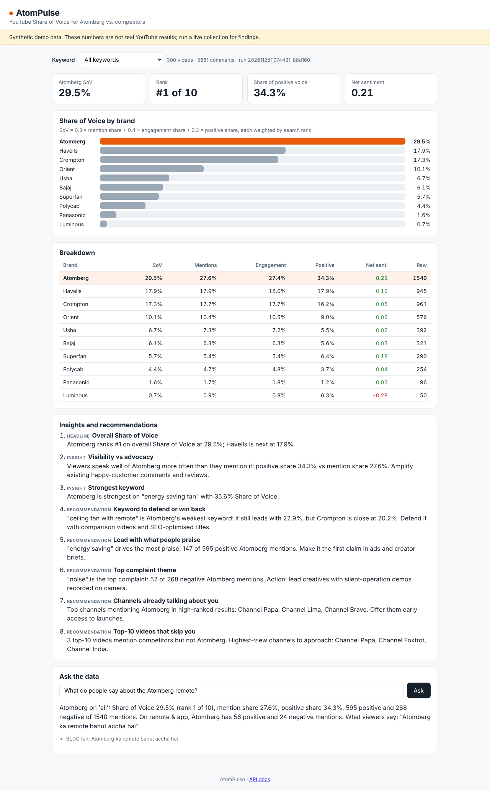

# AtomPulse

**Share of Voice for Atomberg on YouTube, and a test harness that grades the AI that measures it.**

AtomPulse searches YouTube for "smart fan" and five related keywords, reads the top 50 videos and their top
comments, finds every fan-brand mention, scores the sentiment aimed at each brand (English and Hinglish), and
reports Atomberg's Share of Voice against nine competitors. It then writes evidence-backed recommendations for the
content and marketing team, and lets them ask follow-up questions in plain language.

Every stage is guarded and gated in CI: golden-set accuracy, metamorphic properties, LLM faithfulness
(DeepEval, Ragas), red-team refusal (promptfoo), API contract (Postman/Newman, Schemathesis), web E2E
(Playwright), Android (Appium) and load (k6).



> The screenshot and all numbers under "Demo output" use the bundled **synthetic** dataset so everything runs with
> no keys. Run a live collection (below) for real findings.

---

## Quick start

```bash
pip install -e ".[dev]"
atompulse run --source demo        # seed from the bundled synthetic dataset (no keys, no network)
atompulse serve                    # http://127.0.0.1:8000  (API docs at /docs)
pytest -m "not mobile and not llm" # every offline gate + Playwright
```

Live data (needs a free YouTube Data API v3 key):

```bash
cp .env.example .env               # set ATOMPULSE_YOUTUBE_API_KEY (and optionally an LLM)
atompulse run --source youtube     # ~906 of the 10,000 free daily quota units
python scripts/two_pager.py        # writes docs/TWO_PAGER.md for the submission
```

Docker: `docker compose up --build` (seeds a demo run on first boot, serves on :8000).

---

## How it works

```
YouTube Data API ─▶ Collector ─▶ Extractor ─────▶ SoV engine ─▶ FastAPI ─▶ Dashboard (web + mobile)
   search/videos/     ranks,       brands (rules)    M, E, P,       /sov        Ask the data
   commentThreads     stats,       sentiment         SoV            /insights
                      PII redacted (rules | LLM)          │         /ask ◀── guardrails + grounding
                                        │                 ▼
                                        └────────▶ Insights (rules, optional LLM rewrite, grounded)
```

| Stage | What it does | Where |
| --- | --- | --- |
| Collect | `search.list` (N=50, region IN) → `videos.list` → `commentThreads.list` (100 top comments). Retries, quota accounting, comments-disabled handling; raw JSON saved per run for replay | `collector.py` |
| Redact | Emails and Indian phone numbers replaced at ingestion, before anything is stored or sent to an LLM; commenter ids stored as hashes | `text.py` |
| Brands | Deterministic alias matcher with word boundaries ("Renesa", "atom berg", "एटमबर्ग" → Atomberg; "orientation" ≠ Orient; "super fan" ≠ Superfan). **The LLM can never add or remove a brand mention.** | `brands.py` |
| Sentiment | Brand-targeted: "Atomberg is quieter than Crompton" → +/−; "switched from Usha to Atomberg"; negation before and after ("accha nahi"); contrast ("silent but overpriced"); choice questions are neutral; injection comments are never counted as praise. Optional LLM relabel, validated | `sentiment.py`, `extract.py` |
| Score | Share of Voice (below) per keyword and overall | `sov.py` |
| Explain | 8 insight/recommendation types, each carrying its evidence numbers. An LLM may reword them; a rewrite that states a number not in the evidence is rejected | `insights.py` |
| Ask | BM25 retrieval over comments; injection-like comments quarantined; question guardrails (injection, PII, off-topic); answer grounding and PII redaction | `ask.py`, `guardrails.py` |

### The Share of Voice metric

Each result at rank r gets the search-ranking discount **w(r) = 1 / log2(r + 1)** (rank 1 = 1.00, rank 10 = 0.29,
rank 50 = 0.18), because viewers see the top results far more than the 50th. For each brand:

| Part | Definition |
| --- | --- |
| **M**, mention share | rank-weighted mentions; title counts 2, description 1, each comment 1 |
| **E**, engagement share | rank-weighted engagement `ln(1+views) + 2 ln(1+likes) + 3 ln(1+comments)`, split among the brands a video mentions. Logs stop one viral video from dominating |
| **P**, Share of Positive Voice | rank-weighted positive mentions |
| **SoV** | **0.3 M + 0.4 E + 0.3 P** (weights in `config.py`; all parts are reported separately) |

**Why N = 50:** one `search.list` page returns 50 results; very few viewers go past it, and the rank weight already
makes result 50 count 18% as much as result 1. Cost: 100 (search) + 1 (stats) + 50 (comments) ≈ 151 units per
keyword, ≈ 906 for six keywords against a 10,000-unit free daily quota, so the whole study can be re-run 10 times a day.

---

## Quality harness

| Gate | Tool | Threshold | Measured (this repo, demo data) |
| --- | --- | --- | --- |
| Unit + collector (mocked YouTube) | pytest, httpx MockTransport | all pass | pass |
| Metamorphic properties | Hypothesis | 0 violations | comment order, brand-less comments, alias spelling, antisymmetric comparatives: all hold |
| Brand detection | golden **holdout**, 50 comments / 59 brand pairs | F1 ≥ 0.95 | **F1 1.00** |
| Brand-targeted sentiment, rules only | golden **holdout** | macro-F1 ≥ 0.80 | **macro-F1 0.84** (dev set: 0.99) |
| Red-team refusal | own corpus, 40 attacks / 30 benign | ≥ 95% blocked, ≤ 5% false refusals | **40/40 blocked, 0/30 false refusals** |
| LLM guard paths | fake LLMs that lie, leak PII, invent brands | must be rejected | all rejected |
| promptfoo | behaviour + refusal on live `/ask` | all pass | **11/11** |
| API contract | Postman + Newman | all pass | **28/28 assertions, 10 requests** |
| API fuzzing | Schemathesis (OpenAPI) | 0 failures | **201/201** after fixing 2 findings (below) |
| Web E2E | Playwright | all pass | **7/7**, incl. XSS and mobile layout |
| Load | k6, 55 req/s for 60 s | p95 < 500 ms, < 1% errors | **3,302 requests, 0 errors, p95 6.2 ms (reads), 8.5 ms (ask)**, 1 worker, laptop-class box |
| Faithfulness / hallucination | DeepEval, Ragas | faithfulness ≥ 0.8 | needs an LLM key: `make llm-evals` |
| Android | Appium (UiAutomator2, Chrome) | all pass | runs in CI on an emulator: `mobile-appium` job |

**Why two golden sets.** `dev.jsonl` was used while writing the rules, so its 0.99 overstates accuracy.
`holdout.jsonl` was written before tuning and scored once; 0.84 is the honest number. Its 9 errors (in
`reports/golden_holdout.json` after a test run) show the rule engine's limits, e.g. "Atomberg is good, Havells is
bad" split only by a comma, and praise without lexicon words ("sleep mode is lovely"). That gap is the case for
the LLM relabel path, which is validated by the DeepEval/Ragas suite. Both sets are small and hand-labelled by
one person; add real labelled comments from a live run before trusting decimals.

**What the harness caught while building it**

- **Schemathesis** found that `/sov` returned 404 and `/ask` returned 400 on malformed JSON, neither documented in
  the OpenAPI spec. Both are now declared.
- **Playwright** found the dashboard was 588 px wide on a 390 px phone (a grid item would not shrink). Fixed.
- **A unit test** found "Which is better, Atomberg or Havells?" scored both brands positive. Choice questions are now neutral.
- **The golden holdout** exposed over-fitting: dev 0.99 vs holdout 0.84.

Reports land in `reports/` (golden, safety, promptfoo, k6, DeepEval, Ragas) and are uploaded as CI artifacts.

---

## CI (GitHub Actions)

`.github/workflows/ci.yml` runs on every push and PR:

| Job | Runs |
| --- | --- |
| offline-gates | ruff, unit, metamorphic, golden, API, safety |
| live-api | starts the API, then Newman, Schemathesis, promptfoo, k6 |
| e2e-web | Playwright with traces on failure |
| mobile-appium | Android 13 emulator, Appium 2, UiAutomator2 |
| llm-evals | DeepEval + Ragas, only when `RUN_LLM_EVALS=true` and LLM secrets are set |
| docker | builds the image and checks `/health` |

---

## API

| Method | Path | Notes |
| --- | --- | --- |
| GET | `/health` | status, version, data present, LLM configured |
| GET | `/api/v1/keywords` | `all` + each keyword in the latest run |
| GET | `/api/v1/sov?keyword=` | brands sorted by SoV with M, E, P, net sentiment |
| GET | `/api/v1/insights` | insights and recommendations with evidence |
| POST | `/api/v1/ask` | `{question}` → grounded answer, sources, refusal flag |
| POST | `/api/v1/runs` | new collection; needs `X-Admin-Token` |

---

## Configuration

All settings are environment variables with the `ATOMPULSE_` prefix (see `.env.example`). The LLM is optional; any
OpenAI-compatible endpoint works (Groq, Gemini, OpenAI, Ollama). Without one, AtomPulse runs fully on rules.

## Limitations

- YouTube only. Instagram and X have no free official search API for this use.
- Sentiment rules are tuned on fan vocabulary; sarcasm and long comparisons still fail (see holdout errors).
- The red-team corpus is self-written; it is a regression gate, not proof of robustness. `promptfoo/redteam.yaml`
  generates fresh attacks with an LLM.
- Engagement uses video-level statistics; a brand mentioned once in a long comment thread gets a share of the
  whole video's engagement.

## Project layout

```
atompulse/      collector, brands, sentiment, extract, sov, insights, ask, guardrails, store, api, static/
tests/          unit/ (incl. metamorphic), golden/, api/, safety/, e2e/, mobile/, llm/
postman/        Newman collection + environment
promptfoo/      behavioural checks + generated red team
load/           k6 script
scripts/        demo data generator, two-pager writer
```

MIT licence. Built by Gurjas Singh Gandhi.
